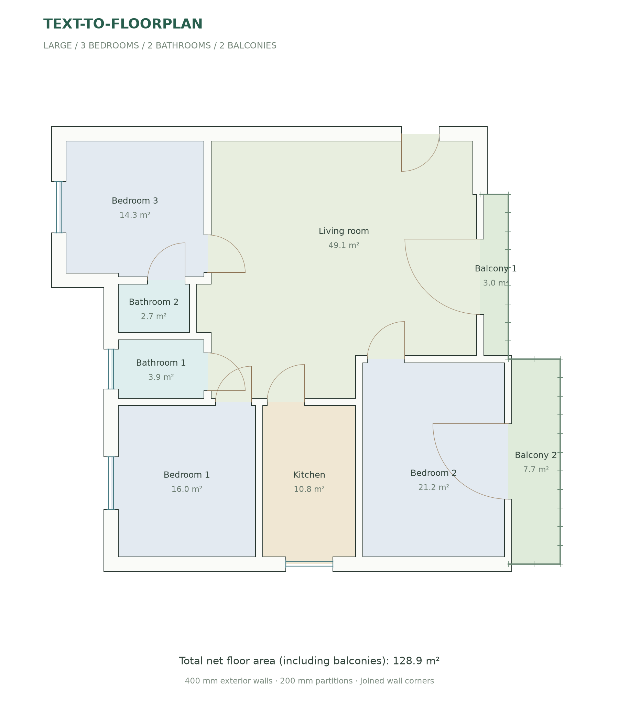
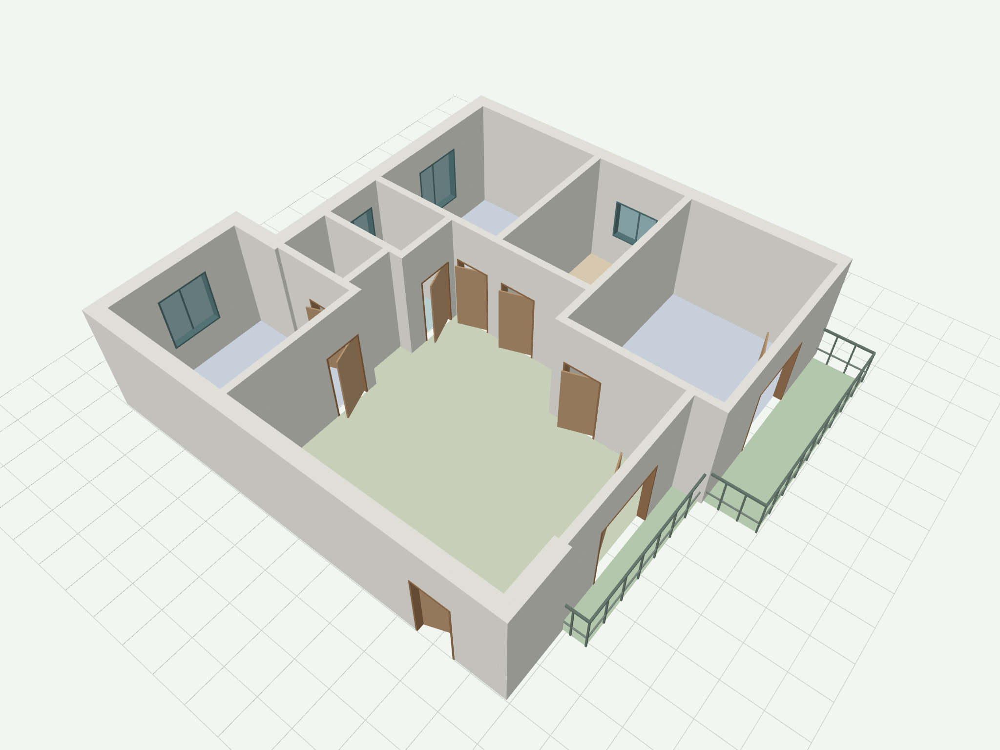
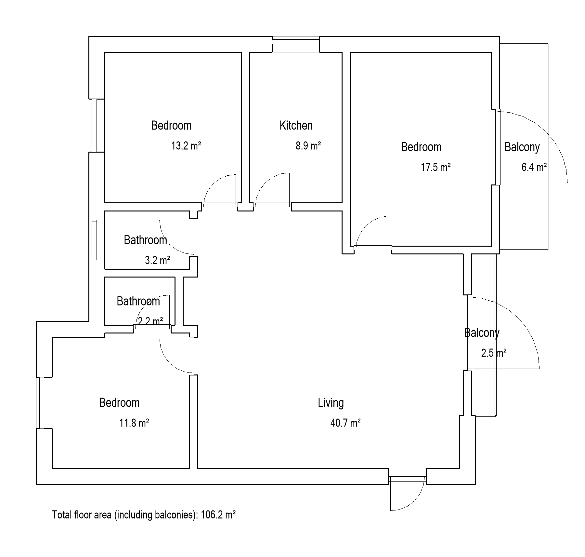
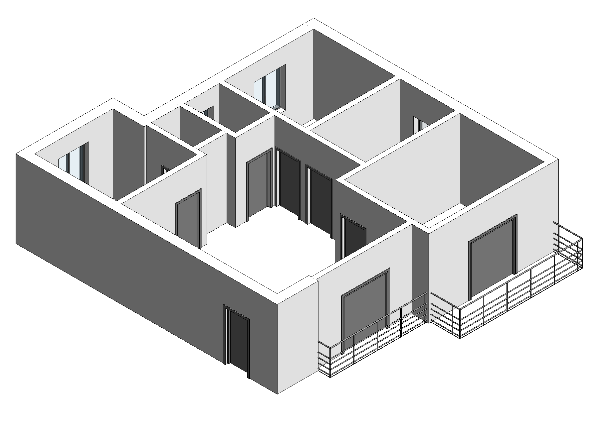

# Text2Floorplan

[中文](README.zh.md)

**Generate editable floor plans and 3D models directly from text — locally, without an LLM or API key.**

Text2Floorplan uses conditional Flow Matching to generate apartment layouts from supported English prompts. Its local browser editor connects an editable 2D plan with a 3D model. An optional C# integration, Text2Floorplan Revit, creates native Autodesk Revit elements from the generated geometry. The repository includes data preparation, training, inference and both interfaces.

## Choose your edition

The two Windows editions are independent. Download only the edition you need;
neither requires the other's launcher or installation.

| Edition | Download | Launch |
| --- | --- | --- |
| Browser workstation — no Revit required | Main Web ZIP and all four Web Data ZIPs | Extract the main ZIP, then run `Start-Text2Floorplan.cmd` inside it |
| Revit plug-in | `text2floorplan_revit-Setup.exe` | Install, then use **Text2Floorplan → Generate Model** in Revit |
| Source-code CLI | This repository, dependencies and compatible weights | `python infer.py --prompt "..."` |

The complete Windows editions include Python, PyTorch and both models; source
users prepare their own environment. Both editions can be installed on one PC,
but currently keep separate runtime/model copies. Generation is local; no LLM
provider, API subscription or cloud inference configuration is needed.

## Examples

```text
A large 3-bedroom apartment with 2 bathrooms and 2 balconies.
```

### Browser editor

The images below show the same calibrated apartment in the local editor: **3 bedrooms, 2 bathrooms, 2 balconies and 128.9 m² net floor area**, including balconies.

| 2D floor plan | Linked 3D model |
| --- | --- |
|  |  |

The [sample](sample/README.md) includes the editable JSON, current calibration and matching area records.

### Revit plug-in

Native **Revit 2022** floor plan and 3D exports, with walls, hosted door/window
families, open balcony railings and area labels. This retained native example
uses the earlier **106.2 m²** calibration.

| Native Revit floor plan | Native Revit 3D model |
| --- | --- |
|  |  |

The matching input and measured areas are preserved as
[`revit-plan.json`](sample/revit-plan.json) and
[`revit-metadata.json`](sample/revit-metadata.json).

## What it generates

- Apartment geometry with walls, doors, windows, rooms and open balcony railings.
- An editable 2D/3D document in the browser workstation; native walls, rooms and
  hosted door/window families in the separate Revit plug-in.
- Room and total floor areas on the plan, together with a 3D view.
- Room-specific window heights and sill heights, sampled in 100 mm increments.
- Geometry checks and regeneration for unsuitable layouts, including kitchens or bathrooms below 2 m².

Window placement avoids the continuous exterior wall containing the entrance. Bedrooms with balcony access receive a balcony door without an additional window. Narrow geometry is repaired before door and window placement, and opening positions are checked for spacing. See the [user guide](revit/guide.md) for dimensions and the [validation report](docs/audit.md) for the checks and their limits.

## Use the browser edition

The **Windows browser edition** runs locally and includes Python, PyTorch, CLIP
and the trained model. It requires neither Revit nor a separate Python/Conda
installation. Inference supports CPU and compatible NVIDIA GPUs; after downloading
the package, generation works offline.

1. From [Releases](https://github.com/Simon777hh/text2floorplan/releases), download
   `Text2Floorplan-Web-Windows.zip` and **every** `Text2Floorplan-Web-Data-*.zip`
   into the same folder.
2. Extract only the main ZIP. Leave the data ZIPs in the download folder and
   double-click **`Start-Text2Floorplan.cmd`** in the extracted `Text2Floorplan` folder.
3. First launch verifies and prepares the runtime, then opens your browser.
   Enter a prompt and click **Generate layout**, or select **Import sample**
   to explore editing immediately. Keep the console open while working.

A complete offline ZIP contains the same files in one download when supplied
through a separate download link. This application uses a local backend; opening
`index.html` directly does not run the model. The interface starts blank, defaults
to English and offers Chinese in the language menu.

### Browser editing

- Synchronized 2D and 3D views, plan pan/zoom, orbit and top view.
- Independent wall endpoint editing and whole-segment movement, with node,
  intersection and wall-line snapping.
- Wall height/thickness, door/window size and sill/base-height controls.
- Door/window transfer between walls with automatic orientation; door swing
  reversal and hinge-side changes. Invalid placements are rejected atomically.
- Room and total net-area recalculation, including balconies. Unclosed spaces
  are explicitly labelled rather than assigned outdated areas.
- Undo/redo, editable JSON import/export and 3D PNG export.

Save the model JSON before refreshing or closing the page. The browser edition
saves editable geometry; native Revit construction uses the separate add-in.
See the [Windows package guide](web_editor/PORTABLE.md) for requirements and
troubleshooting, or the [editor guide](web_editor/README.md) for detailed controls
and source startup.

## Use in Revit

The **Text2Floorplan Revit edition** is distributed as
`text2floorplan_revit-Setup.exe`. It is an alternative to the independent browser
editor. Internal assembly names and existing install locations are retained for
upgrade compatibility.

1. Download `text2floorplan_revit-Setup.exe` from the [Windows release](https://github.com/Simon777hh/text2floorplan/releases). Close Revit, run the installer and select **Install**.
2. Start Revit, open a project floor plan and select **Text2Floorplan → Generate Model**.
3. Enter a supported prompt and select **Generate**. The tool creates the model and opens its 3D view.

The Windows online installer automatically downloads and installs Python, PyTorch, CLIP and the trained model. Only the setup EXE needs to be downloaded manually. Installation requires internet access; subsequent inference runs locally and offline, uses a compatible NVIDIA GPU automatically and supports CPU fallback. No separate Python or Conda installation is required. A complete offline installer can also be distributed separately.

English is the default interface; Chinese is available in the installer and prompt dialog. Both interfaces use the same English prompt format.

### Prompt format

```text
A small 2-bedroom apartment with 1 bathroom and 1 balcony.
A 3-bedroom apartment with 2 bathrooms and 1 balcony.
A large 4-bedroom apartment with 2 bathrooms and 2 balconies.
```

| Condition | How to specify it |
| --- | --- |
| Apartment size | Use `small` or `large`; omit the size for medium |
| Bedrooms | Change the bedroom count |
| Bathrooms | Change the bathroom count |
| Balconies | Change the balcony count |

Each layout includes one living room and one kitchen. The current prompt interface supports these four conditions; other design requirements are not exposed as prompt controls.

### Compatibility

The installer contains separate add-ins for **Revit 2020–2026** and registers each under its matching version. There is no manual DLL selection. All seven targets have been compiled; native model generation has been verified in **Revit 2022**. Runtime validation in the other versions and installation on a clean external PC remain pending.

## Run inference from source

The locally verified environment is Windows x64 with Python 3.14 and PyTorch 2.11. Model weights are not included in the source repository. To run inference from source, provide a compatible trained checkpoint at `checkpoints/flow_matching_best.pth`, or pass its path with `--checkpoint`. Both complete Windows distributions supply the model weights automatically.

For source use, download the **[193 MB inference checkpoint](https://github.com/Simon777hh/Text2Floorplan/releases/download/v1.1.0/flow_matching_best.pth)**
and place it at `checkpoints/flow_matching_best.pth`. Its checksum is available as
[SHA256-model.txt](https://github.com/Simon777hh/Text2Floorplan/releases/download/v1.1.0/SHA256-model.txt).
This standalone download is optional for users of the complete Windows editions.

In a Python environment, run the following from the repository root:

```powershell
python -m pip install -r requirements.txt
python scripts/setup_models.py
python infer.py --prompt "A 3-bedroom apartment with 2 bathrooms and 1 balcony."
```

The setup script downloads the CLIP text encoder once. `infer.py` writes a PNG
and editable JSON to `outputs/inference/`; open the JSON in the browser workstation.
Use `--checkpoint` and `--clip-dir` for model paths, `--device cpu` to force CPU,
and `--output-dir` for another output folder. No Revit, browser or training dataset
is required for CLI generation. Full and inference-only PTH files both work.
See the [inference guide](docs/inference.md) for commands and the shared backend,
and [checkpoint details](checkpoints/README.md) for the 770 MB versus 193 MB exports.

## Data, training and development

| Location | Contents |
| --- | --- |
| `preprocessing/resplan/`, `preprocessing/rplan/` | Dataset cleaning, wall reconstruction, filtering and coordinate preparation |
| `preprocessing/features/` | Ground truth, topology, prompts, masks, edge mapping, CLIP embeddings and validation |
| `data/` | Small statistical priors and geometry settings; see the [file guide](data/README.md) |
| `model.py`, `train.py`, `losses.py` | Model architecture and Flow Matching training |
| `infer.py`, `pipeline_generate.py`, `backend_cli.py` | CLI entry, generation pipeline and shared JSON backend |
| `inference_runtime.py`, `flow_solver.py` | Inference-only model execution and Flow Matching solver |
| `geometry_cleanup.py`, `plan_quality.py`, `door_window_rules.py`, `revit_geometry.py` | Geometry repair, area checks, opening placement and physical dimensions |
| `web_editor/` | Local browser UI, editable 2D/3D document, portable launcher and release builder |
| `revit/` | Optional C# add-in, installer and Revit release builder |
| `sample/`, `tests/`, `docs/` | Examples, regression checks and documentation |

Training datasets are obtained separately. The [data pipeline](docs/data_pipeline.md) describes preparation and validation; the [development guide](docs/development.md) covers the C# implementation, installer builds and verification commands. The [validation report](docs/audit.md) records tested behavior and remaining limitations.

After placing the raw inputs at the paths described in the data guide, run:

```powershell
python -m preprocessing.resplan.prepare_resplan
python -m preprocessing.rplan.prepare_rplan
python -m preprocessing.features.prepare_all_data
```

Each dataset preparation command writes one final dataset and a report. The
training-data command builds GT, filtered topology, prompts, attention data and
CLIP embeddings, then validates their alignment.

## License

Copyright (c) 2026 Simon H.

Original project material is released under the [MIT License](LICENSE). You may use, modify, distribute and use it commercially, provided the copyright and license notice are retained. Third-party components, pretrained model components and separately obtained datasets remain subject to their own terms.

Third-party components and datasets retain their own terms. See [third-party notices](THIRD_PARTY_NOTICES.md).
