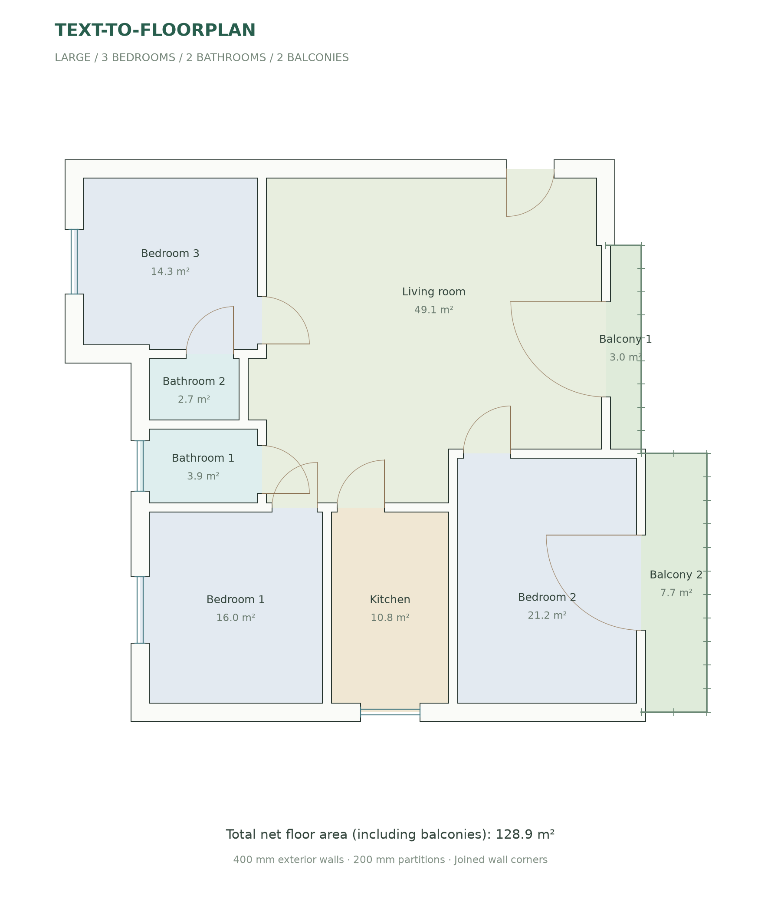
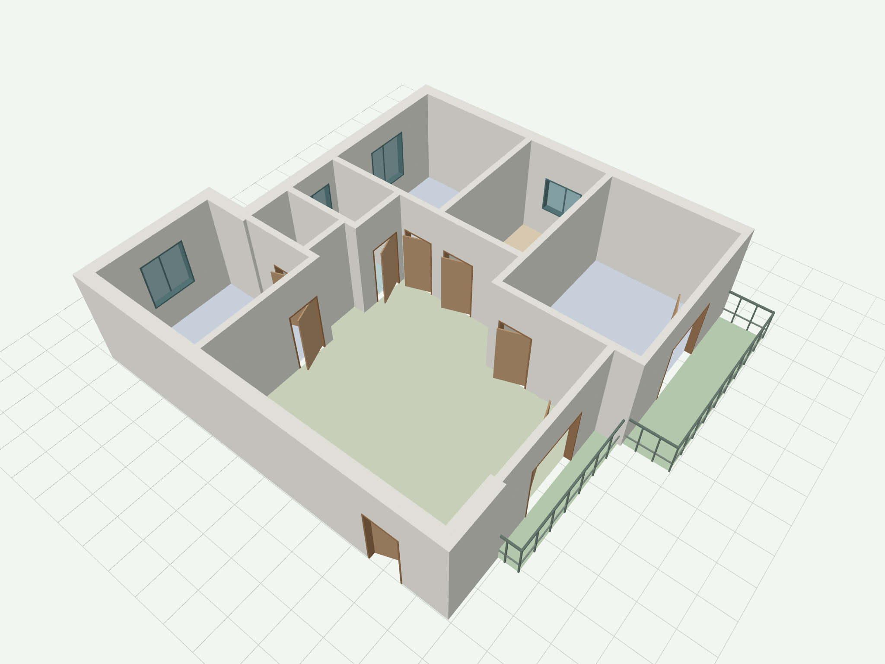
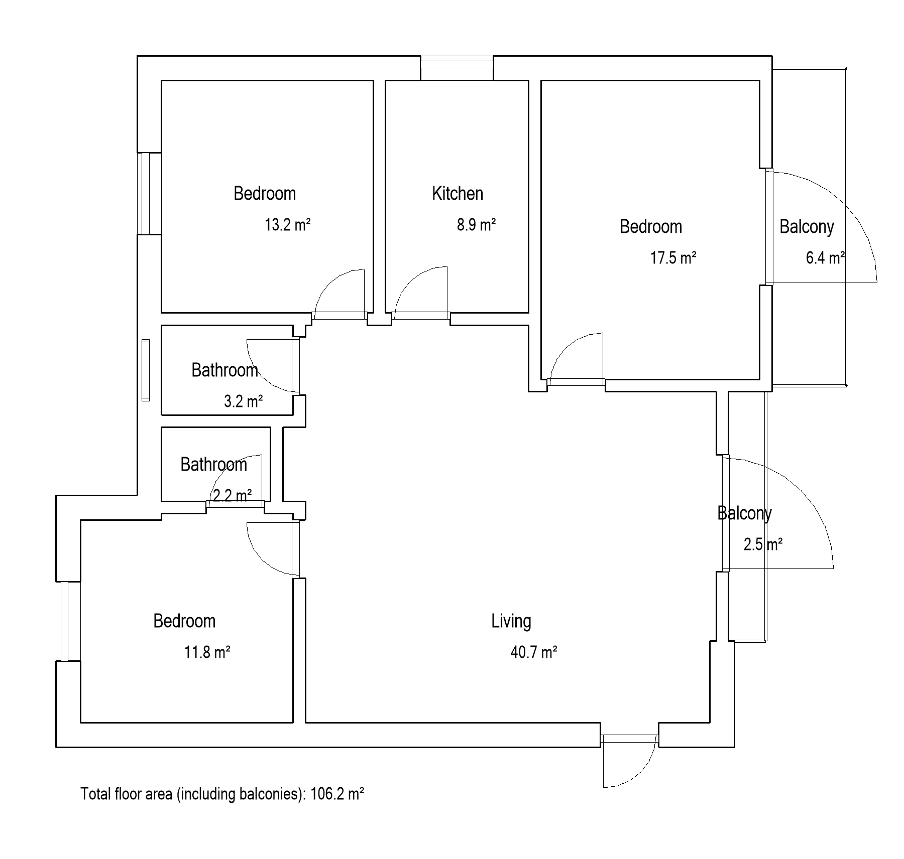
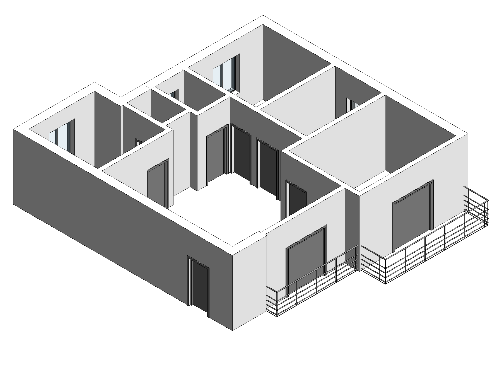

# Text2Floorplan

[English](README.md)

**从文字直接生成可编辑户型图和三维模型，本地运行，无需 LLM 或 API Key。**

Text2Floorplan 使用条件 Flow Matching 模型，根据支持的英文提示词生成户型。本地网页编辑器提供二维平面与三维模型联动；可选的 Text2Floorplan Revit C# 插件通过 Revit API 创建原生建筑构件。仓库包含数据预处理、训练、推理和两种使用界面。

## 选择使用版本

两种 Windows 版本独立使用，只需下载需要的一套，彼此不共用启动器，也不要求
安装另一版本。

| 版本 | 下载内容 | 启动方式 |
| --- | --- | --- |
| 网页工作站，无需 Revit | Web 主 ZIP 和全部四个 Web Data ZIP | 只解压主 ZIP，双击其中的 `Start-Text2Floorplan.cmd` |
| Revit 插件 | `text2floorplan_revit-Setup.exe` | 安装后在 Revit 中点击 **Text2Floorplan → Generate Model** |
| 源码命令行 | 本仓库、依赖和兼容权重 | `python infer.py --prompt "..."` |

完整 Windows 包自带 Python、PyTorch 和模型；源码用户需自行准备环境。两版可在
同一电脑同时使用，但目前各自保留运行环境及模型副本。推理在本地完成，无需配置
LLM 服务、API 订阅或云端推理。

## 示例

```text
A large 3-bedroom apartment with 2 bathrooms and 2 balconies.
```

### 网页版

以下两张图展示本地编辑器中的同一份新版校准户型：**3 个卧室、2 个卫生间、2 个阳台，总净面积 128.9 m²**，含阳台。

| 二维平面 | 联动三维模型 |
| --- | --- |
|  |  |

[示例目录](sample/README.zh.md) 包含可编辑 JSON、当前比例及对应面积记录。

### Revit 插件版

以下为 **Revit 2022 原生导出**的平面和三维图，包含墙体、真实门窗族、
开放阳台栏杆及面积标记。这份保留的原生样例采用较早的 **106.2 m²** 比例。

| Revit 原生平面图 | Revit 原生三维模型 |
| --- | --- |
|  |  |

对应输入与实测面积分别保留在 [`revit-plan.json`](sample/revit-plan.json) 和
[`revit-metadata.json`](sample/revit-metadata.json)。

## 生成内容

- 包含墙体、门窗、房间和开放阳台栏杆的户型几何。
- 网页工作站中的可编辑二维／三维文档；独立 Revit 插件中的原生墙体、房间和真实门窗族。
- 平面图中的各房间及总面积，以及三维视图。
- 按房间类型设置的窗高和窗台高，以 100 mm 为步长采样。
- 几何检查及不合格户型重新生成，包括厨房或卫生间面积小于 2 m² 的情况。

所有窗户避开入户门所在的连续外墙。连接阳台的卧室保留阳台门，不再添加窗户。门窗布置前修复狭窄几何，并检查洞口间距。具体尺寸见 [使用指南](revit/guide.zh.md)，检查范围及局限见 [验证报告](docs/audit.md)。

## 使用网页版

**Windows 网页版**在本机运行，自带 Python、PyTorch、CLIP 和训练权重，
无需 Revit，也无需单独安装 Python 或 Conda。支持 CPU 与兼容的 NVIDIA 显卡，
下载好完整包后可以离线生成。

1. 从 [Releases](https://github.com/Simon777hh/text2floorplan/releases) 下载
   `Text2Floorplan-Web-Windows.zip` 和 **全部** `Text2Floorplan-Web-Data-*.zip`，
   放在同一位置。
2. 只解压主 ZIP，数据 ZIP 留在原下载位置，不用移动；
   进入解压后的 `Text2Floorplan` 文件夹双击 **`Start-Text2Floorplan.cmd`**。
3. 首次自动校验并准备环境，完成后打开浏览器。输入提示词生成，或点击
   **导入样例**直接体验编辑。使用时保留命令窗口。

完整离线 ZIP 将同一套文件放在一个下载中，可通过单独下载地址提供。
程序需要本地后端，不是直接打开 `index.html` 就能运行模型。
初始页面为空白，默认英文，可在语言菜单选择中文。

### 网页编辑功能

- 二维／三维联动，平面平移缩放、三维旋转及俯视。
- 墙的端点与整段独立移动，节点、交点及墙线吸附。
- 墙高墙厚、门窗宽高、窗台高与离地高度修改。
- 门窗跨墙移动并自动转向；门可翻转开门方向、交换铰链侧。
  不合法的放置会拒绝，原模型保留。
- 按当前墙线重算房间与总净面积，含阳台；未闭合空间明确标注。
- 撤销／重做、可编辑 JSON 导入导出及三维 PNG 导出。

刷新或关闭页面前请先保存模型 JSON。网页版保存可编辑几何，原生 Revit
构件通过独立插件创建。运行要求和排查见 [Windows 包说明](web_editor/PORTABLE.zh.md)，
详细操作及源码启动见 [编辑器指南](web_editor/README.zh.md)。

## 在 Revit 中使用

**Text2Floorplan Revit 插件版**的安装包为 `text2floorplan_revit-Setup.exe`，
与独立网页版是两种使用方式。内部程序集名称及原安装位置保留，以兼容已有安装。

1. 从 [Windows 发行版](https://github.com/Simon777hh/text2floorplan/releases) 下载 `text2floorplan_revit-Setup.exe`。关闭 Revit，运行安装器，选择 **Install**。
2. 启动 Revit，打开项目平面视图，选择 **Text2Floorplan → Generate Model**。
3. 输入支持的提示词，选择 **Generate**。插件创建模型并打开三维视图。

Windows 在线安装器自动下载并安装 Python、PyTorch、CLIP 和训练好的模型。用户只需手动下载安装 EXE，无需另外安装 Python 或 Conda。安装需要联网，之后推理在本地离线运行，兼容的 NVIDIA 显卡自动加速，同时支持 CPU 回退。完整离线安装包也可单独提供下载。

界面默认英文，可在安装器和提示词窗口中选择中文。两种界面均使用相同的英文提示词格式。

### 提示词格式

```text
A small 2-bedroom apartment with 1 bathroom and 1 balcony.
A 3-bedroom apartment with 2 bathrooms and 1 balcony.
A large 4-bedroom apartment with 2 bathrooms and 2 balconies.
```

| 条件 | 写法 |
| --- | --- |
| 户型大小 | 使用 `small` 或 `large`；中等户型省略大小 |
| 卧室数 | 修改 bedroom 数量 |
| 卫生间数 | 修改 bathroom 数量 |
| 阳台数 | 修改 balcony 数量 |

每个户型包含一个客厅和一个厨房。目前提示词界面支持这四项条件，其他设计要求尚未作为可调条件提供。

### 兼容性

安装包包含 **Revit 2020–2026** 各版本对应的插件，并分别注册到匹配版本，无需手动选择 DLL。七个版本均已编译；**Revit 2022** 已验证原生模型生成。其他版本的运行验证和全新外部电脑的安装验证仍待完成。

## 从源码运行推理

本地已验证的环境为 Windows x64、Python 3.14 和 PyTorch 2.11。源码仓库不包含模型权重。从源码推理需自行提供兼容的训练权重，放在 `checkpoints/flow_matching_best.pth`，或通过 `--checkpoint` 指定路径。两个完整 Windows 发行版均自动提供使用所需的模型权重。

源码用户可直接下载 **[193 MB 精简推理权重](https://github.com/Simon777hh/Text2Floorplan/releases/download/v1.1.0/flow_matching_best.pth)**，
放到 `checkpoints/flow_matching_best.pth`，校验值见
[SHA256-model.txt](https://github.com/Simon777hh/Text2Floorplan/releases/download/v1.1.0/SHA256-model.txt)。
完整 Windows 版本的用户不需要额外下载这份 PTH。

在 Python 环境中，从仓库根目录运行以下命令：

```powershell
python -m pip install -r requirements.txt
python scripts/setup_models.py
python infer.py --prompt "A 3-bedroom apartment with 2 bathrooms and 1 balcony."
```

初始化脚本首次下载 CLIP 文本编码器。`infer.py` 将 PNG 和可编辑 JSON 写入
`outputs/inference/`，JSON 可在网页工作站中打开。使用 `--checkpoint` 和 `--clip-dir`
指定模型路径，`--device cpu` 强制 CPU，`--output-dir` 修改输出位置。命令行生成
无需 Revit、浏览器或训练数据集，完整及精简 PTH 均可使用。运行方法与共用后端见
[推理指南](docs/inference.zh.md)，770 MB／193 MB 的差异见 [权重说明](checkpoints/README.zh.md)。

## 数据、训练与开发

| 位置 | 内容 |
| --- | --- |
| `preprocessing/resplan/`、`preprocessing/rplan/` | 数据清洗、墙体重建、过滤和坐标准备 |
| `preprocessing/features/` | GT、拓扑、提示词、mask、边映射、CLIP 特征及验证 |
| `data/` | 小型统计先验和几何配置，见 [文件说明](data/README.zh.md) |
| `model.py`、`train.py`、`losses.py` | 模型结构与 Flow Matching 训练 |
| `infer.py`、`pipeline_generate.py`、`backend_cli.py` | 命令行入口、生成管线和共用 JSON 后端 |
| `inference_runtime.py`、`flow_solver.py` | 独立推理执行与 Flow Matching 求解 |
| `geometry_cleanup.py`、`plan_quality.py`、`door_window_rules.py`、`revit_geometry.py` | 几何修复、面积检查、门窗布置和构件尺寸 |
| `web_editor/` | 本地网页、二维／三维模型编辑、便携启动器和打包程序 |
| `revit/` | 可选 C# 插件、安装器和 Revit 发行版构建程序 |
| `sample/`、`tests/`、`docs/` | 示例、回归检查和文档 |

训练数据集需另行获取。[数据流程](docs/data_pipeline.md) 介绍数据准备和验证；[开发指南](docs/development.md) 介绍 C# 实现、安装包构建和检查命令；[验证报告](docs/audit.md) 记录已验证行为及尚存局限。

按照数据说明放好原始输入后，依次运行：

```powershell
python -m preprocessing.resplan.prepare_resplan
python -m preprocessing.rplan.prepare_rplan
python -m preprocessing.features.prepare_all_data
```

两种数据集各自只输出一个最终数据文件和检查报告。训练数据命令生成 GT、
过滤后的拓扑、提示词、注意力数据和 CLIP 特征，最后验证它们的对应关系。

## 许可

Copyright (c) 2026 Simon H.

项目原创内容采用 [MIT License](LICENSE)，允许使用、修改、再分发及商用，须保留版权与许可声明。第三方组件、预训练模型组件及另行获取的数据集仍适用各自条款。

第三方组件和数据集保留其原有条款，详见 [第三方声明](THIRD_PARTY_NOTICES.md)。
